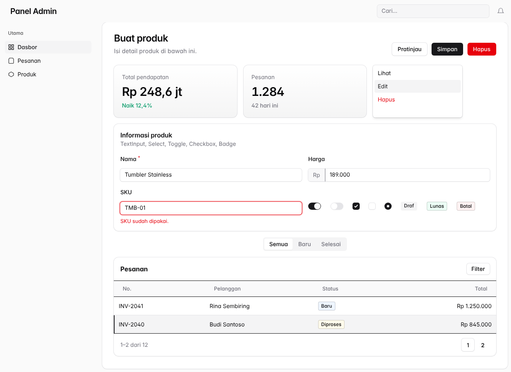
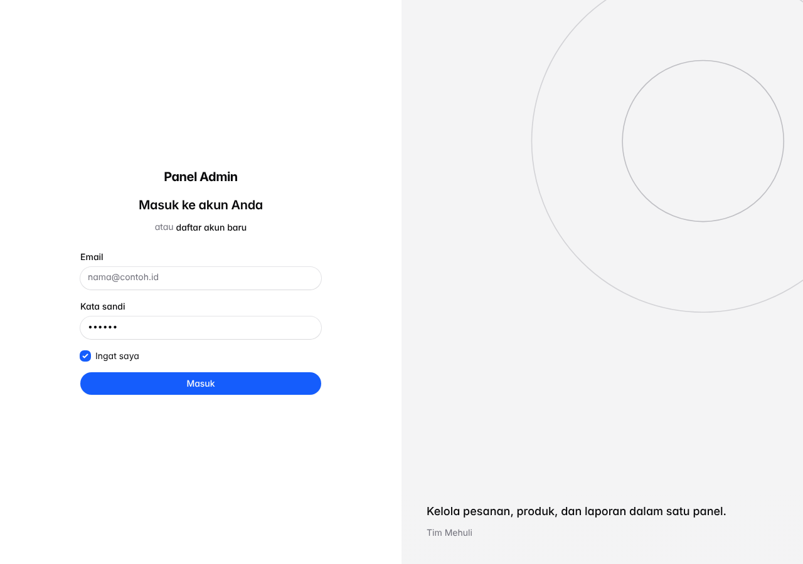
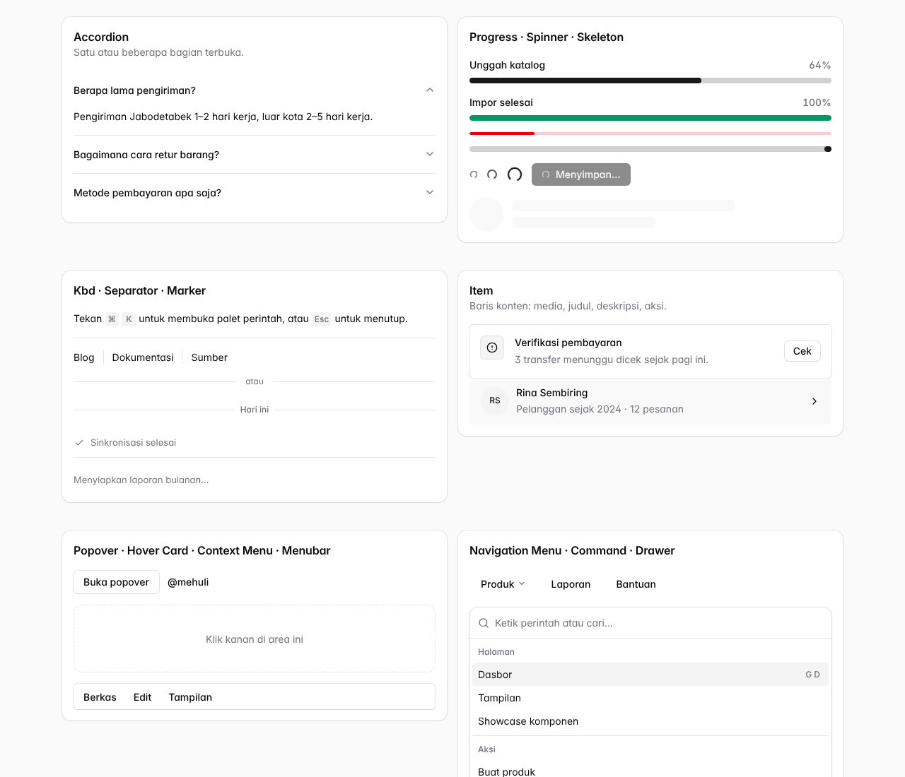

# Filament × shadcn/ui

Template tema untuk **Filament 5** (juga cocok untuk 4.x) dengan tampilan **shadcn/ui**: token warna yang bisa dikustomisasi, 5 gaya komponen, mode terang/gelap, halaman **Tampilan** untuk mengubah warna tanpa deploy, dan halaman **Showcase** berisi semua komponen.

Dikemas sebagai package Laravel `mehuli/filament-shadcn` supaya bisa dipakai ulang di semua proyek.



---

## Isi folder

```
filament-shadcn/
├── composer.json                 package mehuli/filament-shadcn
├── config/filament-shadcn.php    semua pengaturan awal (bisa lewat .env)
├── src/
│   ├── ShadcnPlugin.php          plugin Filament (daftarkan di panel)
│   ├── FilamentShadcnServiceProvider.php
│   ├── Commands/InstallCommand.php   php artisan shadcn:install
│   ├── Support/
│   │   ├── Presets.php           gaya, warna dasar, warna aksen, warna grafik
│   │   ├── ThemeSettings.php     menggabungkan config → kode → halaman Tampilan
│   │   ├── TokenBuilder.php      membuat token CSS shadcn (--primary, --border, …)
│   │   └── AppearanceRepository.php  simpan pilihan halaman Tampilan (JSON)
│   ├── Pages/
│   │   ├── Appearance.php        halaman "Tampilan" (atur gaya & warna)
│   │   └── ComponentShowcase.php halaman berisi semua komponen
│   └── Widgets/                  widget contoh untuk Showcase
├── resources/
│   ├── css/                      CSS tema (tokens, layout, buttons, inputs, …)
│   ├── views/hooks/              <head> token & panel gambar login
│   └── lang/{id,en}/             teks Indonesia & Inggris
├── stubs/
│   ├── theme.css                 file tema panel (salin ke proyek)
│   └── AdminPanelProvider.php    contoh panel provider
└── docs/                         pratinjau & mockup desain acuan (docs/mockup)
```

---

## Instalasi

Persyaratan: PHP 8.2+, Laravel 11/12/13, Filament 5 (atau 4), Node 20+.

> Proyek baru? Pakai **starter kit** `mehuli-id/starter-kit`. Semua langkah di bawah sudah terpasang di sana.

### 1. Pasang package

Package ini ada di repo privat GitHub. Tambahkan ke `composer.json` proyek:

```json
"repositories": [
    { "type": "vcs", "url": "https://github.com/mehuli-id/filament-shadcn" }
]
```

```bash
# sekali per komputer/CI: token GitHub yang punya akses baca ke repo privat
composer config --global github-oauth.github.com <TOKEN>

composer require mehuli/filament-shadcn
```

> Saat mengembangkan package-nya sendiri, pakai `{ "type": "path", "url": "packages/filament-shadcn" }` dan `composer require mehuli/filament-shadcn:@dev`.

### 2. Jalankan installer

```bash
php artisan shadcn:install            # panel "admin"
php artisan shadcn:install --panel=app --config
```

Perintah ini:

1. membuat `resources/css/filament/{panel}/theme.css`;
2. menambahkannya ke `input` di `vite.config.js`;
3. menambahkan `->viteTheme(...)` dan `->plugin(ShadcnPlugin::make())` ke `{Panel}PanelProvider`, lalu menghapus `->colors([...])` bawaan (warna diatur plugin);
4. dengan `--config`, menerbitkan `config/filament-shadcn.php`.

Kalau Panel Provider belum ada, installer menawarkan `make:filament-panel`. Installer aman dijalankan ulang (langkah yang sudah ada dilewati). `--force` menimpa `theme.css`.

Setelah itu jalankan `npm install && npm run build`.

<details>
<summary>Pasang manual (tanpa installer)</summary>

Isi `resources/css/filament/admin/theme.css` dengan `stubs/theme.css`. Intinya dua baris impor ini:

```css
@import '../../../../vendor/filament/filament/resources/css/theme.css';
@import '../../../../vendor/mehuli/filament-shadcn/resources/css/index.css';
```

Tambahkan file itu ke `vite.config.js`, lalu daftarkan di panel (langkah 3).

</details>

### 3. Daftarkan di panel

```php
use Mehuli\FilamentShadcn\ShadcnPlugin;

return $panel
    ->viteTheme('resources/css/filament/admin/theme.css')
    ->darkMode(true)
    ->plugin(ShadcnPlugin::make());
```

Jangan isi `->colors()` atau `->font()` lagi di panel, karena plugin yang mengaturnya. Contoh lengkap ada di `stubs/AdminPanelProvider.php`.

---

## Mengatur warna & gaya

Ada **4 cara**. Yang di bawah menimpa yang di atas:

| # | Cara | Cocok untuk |
|---|------|-------------|
| 1 | `config/filament-shadcn.php` / `.env` | nilai awal tiap proyek |
| 2 | `ShadcnPlugin::make()->primary('blue')…` | panel berbeda dalam satu aplikasi |
| 3 | Halaman **Tampilan** di panel | admin mengubah sendiri tanpa deploy |
| 4 | Token manual (`tokens`) | menempel tema dari ui.shadcn.com/themes atau tweakcn |

### Lewat `.env`

```env
SHADCN_STYLE=nova          # vega | nova | maia | lyra | mira
SHADCN_BASE_COLOR=zinc     # neutral | zinc | slate | stone | gray | mauve | olive | mist | taupe
SHADCN_PRIMARY=default     # default | blue | violet | … | #2563eb | oklch(0.55 0.22 263)
SHADCN_RADIUS=             # kosong = ikut gaya, mis. 0.75
SHADCN_SIDEBAR=inset       # inset | sidebar | floating
SHADCN_AUTH_LAYOUT=muted   # muted | split | plain
SHADCN_AUTH_IMAGE=         # URL gambar untuk layout split
SHADCN_SHOWCASE=false      # true = tampilkan halaman Showcase
```

### Lewat kode

```php
ShadcnPlugin::make()
    ->style('maia')
    ->baseColor('slate')
    ->primary('#0f766e')
    ->colors(['danger' => 'rose', 'success' => 'green'])
    ->radius(0.75)
    ->font('Plus Jakarta Sans', 'JetBrains Mono')
    ->sidebarLayout('floating')
    ->authLayout('split', image: '/images/login.jpg', tagline: 'Melayani dengan sepenuh hati.')
    ->charts(['light' => ['#2563eb', '#0d9488', '#f59e0b', '#8b5cf6', '#e11d48']])
    ->canCustomizeAppearance(fn () => auth()->user()?->is_admin)
    ->showcase(app()->isLocal());
```

### Lewat halaman Tampilan

Menu **Tampilan** (ikon swatch) muncul otomatis. Admin bisa memilih gaya, radius, kerapatan, warna dasar, warna utama (default, nama warna, atau kode warna sendiri), warna status, tata letak sidebar, layout login beserta gambarnya, font, dan token lanjutan.

Pilihan disimpan ke `storage/app/filament-shadcn/appearance.json`, jadi tidak perlu migrasi database. Lokasinya bisa diganti di config `appearance_page`. Batasi akses dengan `->canCustomizeAppearance(...)`, atau matikan dengan `SHADCN_APPEARANCE_PAGE=false`.

### Menempel tema shadcn (tweakcn)

Salin variabel dari ui.shadcn.com/themes atau tweakcn.com ke config:

```php
'tokens' => [
    'light' => ['primary' => 'oklch(0.55 0.22 263)', 'radius' => '0.75rem'],
    'dark'  => ['primary' => 'oklch(0.7 0.15 263)'],
],
```

Bisa juga lewat bagian "Lanjutan" di halaman Tampilan.

---

## Token yang tersedia

Nama token sama dengan shadcn/ui, jadi bisa dipakai juga di CSS dan Blade sendiri:

`--background` `--foreground` `--card` `--card-foreground` `--popover` `--popover-foreground` `--primary` `--primary-foreground` `--secondary` `--secondary-foreground` `--muted` `--muted-foreground` `--accent` `--accent-foreground` `--destructive` `--border` `--input` `--ring` `--chart-1…5` `--sidebar` `--sidebar-foreground` `--sidebar-primary` `--sidebar-accent` `--sidebar-border` `--sidebar-ring` `--radius`

Tambahan dari template ini:

- **Warna status:** `--success`, `--warning`, `--info` beserta `-foreground`.
- **Ukuran:** `--sc-radius-control`, `--sc-radius-card`, `--sc-radius-inset`, `--sc-radius-item`, `--sc-radius-badge`, `--sc-control-height`, `--sc-card-padding`, `--sc-page-padding`, `--sc-gap`, `--sc-row-padding`.
- **Efek:** `--sc-shadow-xs/sm/md/lg`, `--sc-focus`.

Contoh di `theme.css` proyek:

```css
.fi-header-heading { color: var(--primary); }
```

---

## Tata letak (shell)

Bawaannya panel memakai *shell* yang mengikuti mockup di `docs/mockup/`:

- **Sidebar** 16rem: blok merek (kotak ikon + nama + subjudul) di atas, menu pengguna di kaki sidebar.
- **Header di dalam kartu konten**: tombol buka/tutup sidebar, judul halaman atau breadcrumb, pencarian global, pilihan tema ☀/☾/🖥, lonceng notifikasi, dan tautan tambahan.
- **Ponsel**: header berisi ☰, nama merek, lonceng, dan avatar; sidebar jadi laci.

Topbar bawaan Filament dimatikan selama shell aktif. Pengaturannya:

```php
ShadcnPlugin::make()
    ->shell()                                   // false = topbar bawaan Filament
    ->sidebarWidth('16rem')
    ->brand(icon: 'heroicon-o-home', subtitle: 'Toko Utama')
    ->headerLinks([['label' => 'Dokumentasi', 'url' => 'https://…']]);
```

Atau lewat `.env`: `SHADCN_SHELL`, `SHADCN_SIDEBAR_WIDTH`, `SHADCN_BRAND_ICON`, `SHADCN_BRAND_SUBTITLE` (tautan header di `config/filament-shadcn.php` → `layout.header_links`).

Catatan:

- Dengan `->brandLogo()`, logo Filament dipakai apa adanya sebagai ganti kotak ikon.
- Tombol buka/tutup sidebar di desktop hanya muncul bila panel memakai `->sidebarCollapsibleOnDesktop()`.
- Lonceng tampil di header bila `->databaseNotifications()` aktif (kecuali posisinya diatur sendiri).
- Pencarian global muncul bila ada resource yang bisa dicari.

### Widget bergaya shadcn

```php
use Mehuli\FilamentShadcn\Widgets\Stat;          // pengganti Filament\Widgets\StatsOverviewWidget\Stat
use Mehuli\FilamentShadcn\Widgets\ChartWidget;   // pengganti Filament\Widgets\ChartWidget

Stat::make('Total pendapatan', 'Rp 248,6 jt')
    ->trend('+12,4%', up: true)                   // badge di kanan atas
    ->description('Naik bulan ini')                // baris tebal + ikon tren
    ->hint('Pendapatan 6 bulan terakhir');         // baris kecil abu-abu

class RevenueChart extends ChartWidget { /* getData(), getFilters(), getType() seperti biasa */ }
```

`ChartWidget` memberi warna tiap seri dari `--chart-1…5` (ikut mode gelap), garis halus dengan isian gradasi, legenda kotak di bawah, dan filter sebagai tombol bersegmen. Warna yang ditulis sendiri di dataset tetap dipakai.

---

## Gaya komponen

| Gaya | Radius | Tinggi kontrol | Ciri |
|------|--------|----------------|------|
| **vega** | 0.625rem | 36px | klasik shadcn (dulu "New York") |
| **nova** | 0.5rem | 32px | padat, cocok untuk admin (bawaan) |
| **maia** | 1rem | 36px | tombol, input, badge berbentuk pil |
| **lyra** | 0 | 32px | kotak tajam, font monospace |
| **mira** | 0.375rem | 28px | paling rapat, untuk tabel data |

Radius memetakan skala Tailwind (`rounded-sm/md/lg/xl`) ke `--radius`, sehingga semua komponen Filament ikut berubah. Kerapatan mengatur `--spacing` Tailwind.

---

## Komponen yang sudah ditata

- **Tata letak:** sidebar (inset / klasik / mengambang), topbar, breadcrumbs, judul halaman, user & tenant menu, pengalih tema terang/gelap/sistem, sub-navigasi.
- **Aksi:**
  - Tombol: default, outline, destructive, sukses/peringatan/info, outlined, link.
  - Ukuran tombol xs–xl.
  - Tombol ikon, grup tombol, ToggleButtons.
  - Badge.
- **Form:**
  - Input & wrapper: TextInput (prefix/suffix, error, disabled), Textarea, OTP.
  - Pilihan: Select native & searchable/multiple, Checkbox, CheckboxList, Radio, Toggle, ToggleButtons, Slider, TagsInput.
  - Struktur: Repeater (termasuk mode tabel), Builder, KeyValue, Fieldset.
  - Editor: RichEditor, MarkdownEditor, CodeEditor.
  - Media & tanggal: DateTimePicker, ColorPicker, FileUpload (dan editor gambarnya).
- **Schema:** Section/Card (termasuk aside), Tabs, Wizard, Callout, Empty state, Text.
- **Tabel:** header, toolbar, pencarian, filter, baris terpilih/striped, grup, ringkasan, layout grid, empty state, pagination.
- **Infolist:** TextEntry, IconEntry, ColorEntry, KeyValueEntry, RepeatableEntry, CodeEntry.
- **Lapisan:** Modal, Slide-over, Dropdown, Tooltip, Global search, notifikasi toast & database.
- **Widget:** Stats overview, Chart (warna `--chart-1…5`), Account.
- **Halaman login, daftar, lupa sandi:** layout muted, split dengan gambar, atau polos.

Buka **Showcase komponen** (`SHADCN_SHOWCASE=true`) untuk melihat semuanya di satu halaman.



---

## Komponen tambahan `<x-shadcn::…>`

Untuk komponen shadcn/ui yang tidak ada di Filament, template ini menyediakan **Blade component** (Blade + Alpine.js, tanpa dependensi tambahan). Komponen ini bisa dipakai di halaman Filament kustom, widget, `View::make()` di schema, atau Blade biasa. Warnanya ikut token tema.

| Komponen | Contoh |
|---|---|
| Accordion | `<x-shadcn::accordion default="a"><x-shadcn::accordion.item value="a" title="Judul">Isi</x-shadcn::accordion.item></x-shadcn::accordion>` |
| Aspect Ratio | `<x-shadcn::aspect-ratio ratio="16/9"></x-shadcn::aspect-ratio>` |
| Attachment | `<x-shadcn::attachment name="laporan.pdf" description="PDF · 1,2 MB" state="uploading" :progress="64" />` |
| Bubble | `<x-shadcn::bubble variant="secondary" align="end">Halo</x-shadcn::bubble>` |
| Carousel | `<x-shadcn::carousel :per-view="2"><x-shadcn::carousel.item>…</x-shadcn::carousel.item></x-shadcn::carousel>` |
| Code Block | `<x-shadcn::code-block title="config.php" :code="$kode" line-numbers :highlight="[3]" />` (juga `diff`, `wrap`, `max-height`) |
| Command | `<x-shadcn::command :items="$items" dialog shortcut="k" />` (palet ⌘K) |
| Context Menu | `<x-shadcn::context-menu>area…<x-slot:menu><x-shadcn::menu.item>Buka</x-shadcn::menu.item></x-slot:menu></x-shadcn::context-menu>` |
| Direction | `<x-shadcn::direction dir="rtl">…</x-shadcn::direction>` |
| Drawer | `<x-shadcn::drawer title="…" side="bottom">` + slot `trigger` / `footer` |
| Hover Card | `<x-shadcn::hover-card>` + slot `trigger` |
| Item | `<x-shadcn::item variant="outline">` + `item.media`, `item.title`, `item.description`, `item.actions` |
| Kbd | `<x-shadcn::kbd.group><x-shadcn::kbd>⌘</x-shadcn::kbd><x-shadcn::kbd>K</x-shadcn::kbd></x-shadcn::kbd.group>` |
| Marker | `<x-shadcn::marker variant="separator">Hari ini</x-shadcn::marker>` |
| Menubar | `<x-shadcn::menubar><x-shadcn::menubar.menu label="Berkas">…</x-shadcn::menubar.menu></x-shadcn::menubar>` |
| Message, Message Scroller | `<x-shadcn::message-scroller height="20rem"><x-shadcn::message align="end">…</x-shadcn::message></x-shadcn::message-scroller>` |
| Navigation Menu | `<x-shadcn::navigation-menu><x-shadcn::navigation-menu.item label="Produk">…</x-shadcn::navigation-menu.item></x-shadcn::navigation-menu>` |
| Popover | `<x-shadcn::popover>` + slot `trigger` |
| Progress | `<x-shadcn::progress :value="64" label="Unggah" show-value color="success" />` |
| Questionnaire | `<x-shadcn::questionnaire :items="$pertanyaan" wire="simpanJawaban" />` |
| Resizable | `<x-shadcn::resizable :default="30" with-handle>` + slot `start` / `end` |
| Scroll Area | `<x-shadcn::scroll-area height="18rem">…</x-shadcn::scroll-area>` |
| Separator | `<x-shadcn::separator />`, `<x-shadcn::separator label="atau" />` |
| Skeleton, Spinner | `<x-shadcn::skeleton width="12rem" height="1rem" />`, `<x-shadcn::spinner size="lg" />` |
| Trace | `<x-shadcn::trace><x-shadcn::trace.line status="running" title="Mengimpor data" /></x-shadcn::trace>` |
| Typography | `<x-shadcn::typography><h1>…</h1><p class="sc-lead">…</p></x-shadcn::typography>` (gaya h1–h4, p, blockquote, list, code, tabel; kelas sc-lead/large/small/muted) |

Contoh lengkap setiap komponen (beserta semua prop-nya) ada di komentar bagian atas file masing-masing di `resources/views/components/`, dan di halaman **Komponen shadcn** (muncul bersama Showcase saat `SHADCN_SHOWCASE=true`).

### Untuk tabel, infolist, dan form Filament

```php
use Mehuli\FilamentShadcn\Tables\Columns\ProgressColumn;
use Mehuli\FilamentShadcn\Infolists\Components\{ProgressEntry, CodeBlockEntry};
use Mehuli\FilamentShadcn\Schemas\Components\{Accordion, AccordionItem};

ProgressColumn::make('stock_percentage')->maxValue(100)->color(fn ($state) => $state < 20 ? 'danger' : 'primary');
ProgressEntry::make('progress')->label('Progres');
CodeBlockEntry::make('payload')->title('Respons API')->lineNumbers();

Accordion::make([
    AccordionItem::make('Pengiriman')->schema([/* field … */]),
    AccordionItem::make('Pembayaran')->schema([/* field … */]),
])->multiple();
```

### Cakupan dibanding daftar komponen shadcn/ui

Semua 66 komponen di ui.shadcn.com/docs/components sekarang punya padanan:

- **38** lewat komponen bawaan Filament yang sudah ditata ulang.
- **28** lewat `<x-shadcn::…>`: 11 yang sebelumnya baru sebagian dan 10 yang belum ada sama sekali, ditambah 7 komponen chat/AI (Attachment, Bubble, Marker, Message, Message Scroller, Questionnaire, Trace).

Syntax highlighting di Code Block belum ada (teks polos). Kalau perlu, bisa disambungkan ke Phiki atau Torchlight.



---

## Keamanan

- **Halaman Tampilan** mengubah tampilan untuk semua user. Tanpa `->canCustomizeAppearance(...)` halaman ini hanya muncul di `APP_ENV=local`. Di production tentukan siapa yang boleh, misalnya `->canCustomizeAppearance(fn (): bool => (bool) auth()->user()?->is_admin)`.
- **Nama font** hanya boleh huruf, angka, spasi, titik, dan tanda hubung, karena Filament mencetaknya tanpa escape di `<style>`.
- **Token kustom** hanya boleh berisi warna, ukuran, `calc()`, dan `var()`. `url()`, `image-set()`, tanda kutip, titik dua, dan `//` ditolak.
- **Warna utama kustom** harus `#hex`, `rgb(r, g, b)`, atau `oklch(l c h)`. Nilai lain kembali ke bawaan.
- **Gambar login** hanya PNG/JPEG/WebP/AVIF (tanpa SVG), maksimal 4 MB. Atur lewat `appearance_page.image_types` dan `image_max_kb`.
- **Link di komponen** (`href`, URL item `command`) menolak skema `javascript:`, `vbscript:`, `data:`, dan `file:`. Atur lewat `blocked_url_schemes`.
- **Showcase** mati secara bawaan. Jangan aktifkan di production.

## Catatan

- CSS sudah dicek lolos kompilasi Tailwind v4 bersama source Filament 5.10. Semua file PHP lolos `php -l`.
- **Ponsel & tablet:** tata letak panel mengikuti perilaku responsif Filament. Varian sidebar inset/mengambang dan login split hanya aktif di layar ≥ 1024px, di bawah itu otomatis kembali ke tampilan satu kolom. Komponen `<x-shadcn::…>` sudah diuji di lebar 390px dan 820px:
  - tidak ada yang meluber ke luar layar;
  - panel mengambang (popover, hover card, menu) otomatis digeser agar tetap di dalam layar;
  - Hover Card bisa dibuka dengan ketukan;
  - Carousel menyesuaikan jumlah slide;
  - area sentuh menu diperbesar di layar sentuh.
- Komponen `<x-shadcn::…>` sudah dirender dengan Blade (Laravel 12) dan Alpine.js tanpa error, termasuk keadaan interaktifnya (palet perintah, drawer, menu, questionnaire, carousel).
- Gambar di `docs/` adalah **pratinjau statis**: HTML tiruan dengan class Filament, bukan tangkapan layar aplikasi sungguhan. Saat pertama dipasang, cek halaman Showcase dan sesuaikan detail kecil di `resources/css/*.css` bila perlu.
- Aturan CSS tidak dimasukkan ke `@layer`, supaya selalu menang atas gaya bawaan Filament tanpa `!important`. Kalau ingin menimpanya, tulis aturan Anda di `theme.css` setelah baris impor.
- Ganti nama package/namespace (`mehuli/filament-shadcn`, `Mehuli\FilamentShadcn`) bila perlu: cukup cari-ganti di `composer.json`, `src/`, dan `stubs/`.
